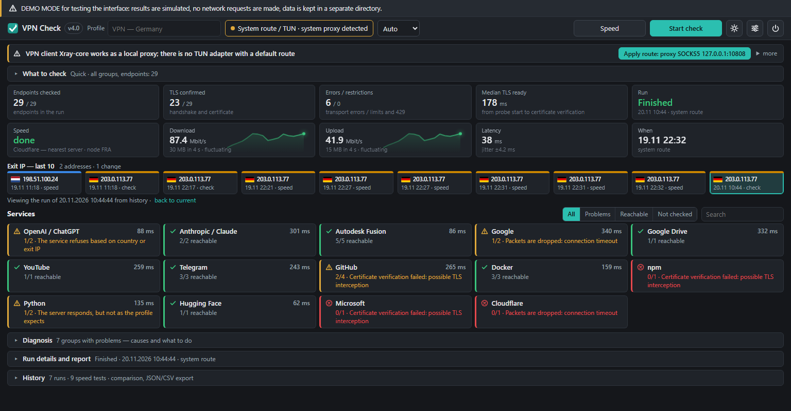

# VPN Check

**Is it the VPN, the route, or the service?** VPN Check is a small local Windows tool that checks
which services are reachable through your current VPN (or an explicit proxy), measures the speed of
the route, and explains *why* something does not open: a geo-block by the service, DPI resetting the
TLS handshake, TLS interception, traffic bypassing the VPN, DNS spoofing, rate limits.

One `VPNCheck.exe`, no installation, no admin rights, no cloud, no account. The interface opens in
your browser and talks only to `127.0.0.1`.

[Русская версия](README.ru.md) · Interface languages: English, Русский, Deutsch, 中文, فارسی, العربية



## What it does

- **Reachability of reference endpoints** of OpenAI/ChatGPT, Anthropic/Claude, Google, YouTube,
  Telegram, GitHub, Docker, npm, PyPI, Hugging Face, Microsoft, Cloudflare, Autodesk Fusion and your
  own HTTPS hosts. Each probe is one TLS handshake with certificate verification, or one small GET;
  DNS, TCP, proxy, TLS and time to first byte are measured on that same connection.
- **Verdicts with a reason and advice** for every group, for example "the service refuses your exit
  country (`403 unsupported_country`)", "TLS reset after SNI: active blocking", "certificate not
  trusted: TLS interception or a wrong clock".
- **Environment passport** without any network access: running VPN clients, TUN adapters and the
  default route, split tunnelling, local proxies, Windows proxy settings. The recommended route is
  one click away.
- **Two-route diagnosis**: probes a problem group through the selected route *and* the alternative
  one (local proxy of the VPN client vs. the system route), which shows whether applications bypass
  the VPN.
- **Speed test** through the same route: latency, download and upload via Cloudflare's nearest node
  (its city code is shown), or download from Hetzner in Falkenstein or Helsinki as a fixed reference.
- **Split-routing check** ("Russia direct" group): compares the address a Russian site (Yandex
  Internetometer) sees with the exit seen by Cloudflare through the same route, and tells whether
  Russian sites go direct while everything else goes through the VPN: a Russian flag when they do,
  a red card with the country they go through when they do not. The country is looked up in
  RIPEstat (RIPE NCC). It only observes and never changes routes or VPN rules.
- **Exit IP log**: the last 10 checks and speed tests with exit IP, country flag and time; the same
  address always has the same colour, so changes of the exit are visible at a glance.
- **History and export**: the last 100 runs, comparison of two runs, JSON/CSV export and a full
  diagnostic JSON report meant for a human or an LLM to read.

## Gentle by design

VPN Check is meant to be pressed by a person now and then, never to load anybody's servers:

- probes: at most 4 at a time and one per host, a pause between runs (60 s by default, adjustable),
  no redirects, no retries, at most 64 KiB read per response; a host that answers 403 or a CAPTCHA
  is not probed again in that run, 429 pauses it according to `Retry-After` (15 min otherwise);
- speed test: only on request, 8 s per phase, 4 connections, about 150 MB down and 50 MB up at most,
  3 minutes between tests and at most 20 a day; 429, 403 or a challenge stops the test at once and
  pauses that server;
- an honest `User-Agent: VPNCheck/<version> (...)`, no browser impersonation.

## Download and run

1. Download `VPNCheck-<version>-windows-amd64.zip` from
   [Releases](https://github.com/andreybuteo/VPNCheck/releases), unpack it and check the SHA-256
   against `VPNCheck.exe.sha256`. The binary is **not code-signed**, so SmartScreen may warn; do not
   switch Windows protection off, compare the checksum instead.
2. Connect your VPN and run `VPNCheck.exe`. The interface opens in the default browser.
3. Check the route shown in the header (system route / TUN, or the local proxy of your VPN client),
   press **Start check**, then **Speed** if you want a speed test.

Closing the browser tab does not stop the program; use the power button in the header. Command line:
`--no-browser`, `--port N`, `--data-dir PATH`, `--version`, `--demo` (fabricated results and no
network at all, for trying the interface).

Data lives in `%LOCALAPPDATA%\VPNCheck` (settings, history, limits, log). External IPs and proxy
addresses are hidden in exports unless you ask for detailed data.

## Languages

All six interface languages are built into the exe. The language follows your browser/Windows and
can be switched in the header. Verdicts, errors and exports are written in the selected language.

Translations live in [`internal/i18n/locales`](internal/i18n/locales) as JSON maps from the Russian
source text to the translation. The source texts are collected by `go run ./tools/i18nkeys` into
`internal/i18n/keys.json`; `go test ./internal/i18n` fails if a language misses a key or changes a
`%s`/`%d` placeholder. Corrections by native speakers are very welcome, especially for Chinese,
Persian and Arabic.

## Build from source

Requires Go 1.27 on Windows (`winget install GoLang.Go`):

```powershell
.\build.ps1 -Version 4.0
```

The script runs `go vet` and `go test`, builds `dist\VPNCheck.exe` (no CGO, standard library only,
`-trimpath -ldflags "-s -w -H windowsgui"`), prints size and SHA-256 and creates the release ZIP.

```
cmd/vpncheck/   entry point, Windows resources
internal/       probes, address guard, limiter, classification, diagnosis, speed test,
                registry, storage, reports, API, HTTP server, i18n
web/            interface (HTML/CSS/JS), embedded into the exe
tools/          icon generator, translation key extractor
docs/           specification, registry of reference endpoints, test report (Russian)
```

## Limitations

- Reference endpoints are checked, not full application scenarios: a reachable YouTube page does
  not prove that video plays, TLS to an API does not prove that a model call succeeds.
- Verdicts are heuristics without packet capture or admin rights; each shows its confidence.
- Speed figures are close to, but not the same as, speedtest.net: the server is different.
- Windows 11 x64 is the target; the code builds on other systems, but the environment passport and
  proxy detection are Windows-only.

## For AI assistants

[`llms.txt`](llms.txt) and [`docs/ai-guide.yaml`](docs/ai-guide.yaml) describe the tool in a
machine-readable form: settings, custom endpoints, verdict codes, how to read a report and how to
adapt the tool to a particular user. Give them to an assistant together with a saved JSON report.

## License

[MIT](LICENSE)
